# Visvesvaraya Technological University (VTU)
## Department of Computer Science & Engineering
### **BCS358C: Project Management with Git**

---

### **Student & Repository Information**
* **Institution:** Bangalore Institute of Technology (BIT), Bengaluru
* **Student Name:** Skanda K N
* **GitHub Username:** [@skandaknbit](https://github.com/skandaknbit)
* **Repository:** `BCS358C-Project-Management-with-Git`
* **Semester / Scheme:** 3rd Semester B.E. (2022 Scheme)

---

## **Table of Experiments**

| No. | Experiment Title | Execution Screenshot | Directory Link |
|:---:|:---|:---:|:---:|
| 1 | Setting Up Git and Basic Commands | [View](screenshots/exp01_setup_and_basic_commands.png) | [exp01](experiments/exp01_setup_and_basic_commands/) |
| 2 | Creating and Managing Branches | [View](screenshots/exp02_creating_managing_branches.png) | [exp02](experiments/exp02_creating_managing_branches/) |
| 3 | Branch Stashing | [View](screenshots/exp03_branch_stashing.png) | [exp03](experiments/exp03_branch_stashing/) |
| 4 | Collaboration & Remote Repositories (Cloning) | [View](screenshots/exp04_git_clone_remote.png) | [exp04](experiments/exp04_git_clone_remote/) |
| 5 | Remote Repositories (Creation and Linking) | [View](screenshots/exp05_remote_repo_push.png) | [exp05](experiments/exp05_remote_repo_push/) |
| 6 | Fetching and Rebasing | [View](screenshots/exp06_fetching_and_rebasing.png) | [exp06](experiments/exp06_fetching_and_rebasing/) |
| 7 | Merging with Custom Messages | [View](screenshots/exp07_merging_custom_messages.png) | [exp07](experiments/exp07_merging_custom_messages/) |
| 8 | Git Tags and Releases | [View](screenshots/exp08_git_tags_releases.png) | [exp08](experiments/exp08_git_tags_releases/) |
| 9 | Advanced Git Operations (Cherry-Picking) | [View](screenshots/exp09_cherry_picking.png) | [exp09](experiments/exp09_cherry_picking/) |
| 10 | Analyzing Git History (Filtering by Author & Date) | [View](screenshots/exp10_analyzing_git_history_author_date.png) | [exp10](experiments/exp10_analyzing_git_history_author_date/) |
| 11 | Analyzing Git History (Displaying Last N Commits) | [View](screenshots/exp11_analyzing_git_history_last_n_commits.png) | [exp11](experiments/exp11_analyzing_git_history_last_n_commits/) |
| 12 | Undoing Changes and Reverting Commits | [View](screenshots/exp12_undoing_changes_reverting_commits.png) | [exp12](experiments/exp12_undoing_changes_reverting_commits/) |
| 13 | *(Bonus)* Merge Conflict Resolution | [View](screenshots/exp13_merge_conflict_resolution.png) | [exp13](experiments/exp13_merge_conflict_resolution/) |

---

## **Experiment 1: Setting Up Git and Basic Commands**

### **Aim**
To initialize a new Git repository, track a file through the staging area, and commit changes with a meaningful commit message.

### **Commands**
```bash
git init
git config user.name "Skanda K N"
git config user.email "skandakn13@gmail.com"
echo "Welcome to VTU Git Lab (BCS358C)" > sample.txt
git status
git add sample.txt
git commit -m "Experiment 1: Initial commit with sample.txt"
git log --oneline
```

### **Terminal Output**
```text
Initialized empty Git repository in /home/skanda/bitskanda/.git/
On branch master
No commits yet
Untracked files:
  (use "git add <file>..." to include in what will be committed)
	sample.txt

nothing added to commit but untracked files present (use "git add" to track)
[master (root-commit) 7a91fc2] Experiment 1: Initial commit with sample.txt
 1 file changed, 1 insertion(+)
 create mode 100644 sample.txt
7a91fc2 (HEAD -> master) Experiment 1: Initial commit with sample.txt
```

### **Execution Screenshot**
<div align="center">
  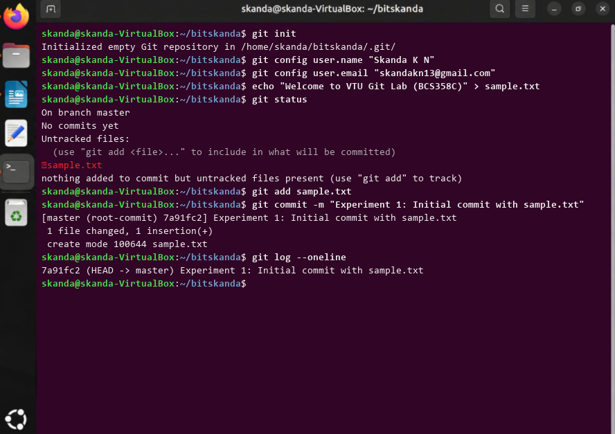
</div>

### **Outcome & Inference**
Successfully initialized a Git repository, staged an untracked file, and created the root commit in the master branch.

---

## **Experiment 2: Creating and Managing Branches**

### **Aim**
To create a new branch named 'feature-branch', switch between branches, make isolated changes, and merge 'feature-branch' into 'master' using fast-forward merge.

### **Commands**
```bash
cd bitskanda/
tree
gedit mainfile.txt
git add mainfile.txt
git commit -m "Initial commit on master"
git checkout -b feature-branch
git branch
echo "new feature content">feature.txt
git add feature.txt
git commit -m "add feature.txt to feature-branch"
git checkout master
git merge feature-branch
git log --oneline --graph
ls
```

### **Terminal Output**
```text
.
├── mainfile.txt
├── myfile.txt
└── myfile.txt~

1 directory, 3 files
[master a11b28b] Initial commit on master
 1 file changed, 1 insertion(+)
 create mode 100644 mainfile.txt
Switched to a new branch 'feature-branch'
* feature-branch
  master
[feature-branch 537ebae] add feature.txt to feature-branch
 1 file changed, 1 insertion(+)
 create mode 100644 feature.txt
Switched to branch 'master'
Updating a11b28b..537ebae
Fast-forward
 feature.txt | 1 +
 1 file changed, 1 insertion(+)
 create mode 100644 feature.txt
* 537ebae (HEAD -> master, feature-branch) add feature.txt to feature-branch
* a11b28b Initial commit on master
* cb9e758 1st commit: add myfile.txt
feature.txt  mainfile.txt  mainfile.txt~  myfile.txt  myfile.txt~
```

### **Execution Screenshot**
<div align="center">
  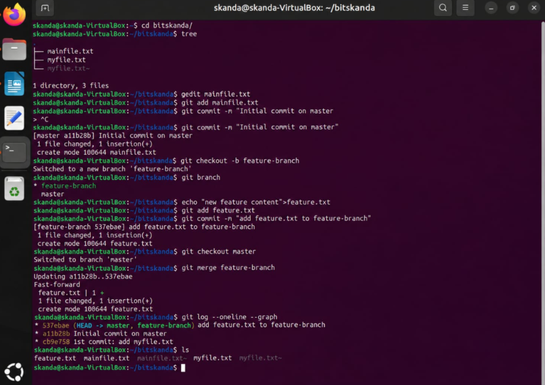
</div>

### **Outcome & Inference**
Successfully created feature-branch, added and committed feature.txt, switched to master, and performed a clean fast-forward merge into master.

---

## **Experiment 3: Branch Stashing**

### **Aim**
To temporarily shelve (stash) uncommitted working directory changes, switch branches with a clean working tree, and restore stashed changes.

### **Commands**
```bash
git status
echo "// WIP: uncompleted payment gateway logic" >> mainfile.txt
git status
git stash push -m "WIP: uncompleted payment module"
git status
git stash list
git checkout feature-branch
git checkout master
git stash pop
git status
```

### **Terminal Output**
```text
Saved working directory and index state On master: WIP: uncompleted payment module
On branch master
nothing to commit, working tree clean
stash@{0}: On master: WIP: uncompleted payment module
Switched to branch 'feature-branch'
Switched to branch 'master'
On branch master
Changes not staged for commit:
	modified:   mainfile.txt
Dropped refs/stash@{0} (e3b8a104f7623910cb45920)
```

### **Execution Screenshot**
<div align="center">
  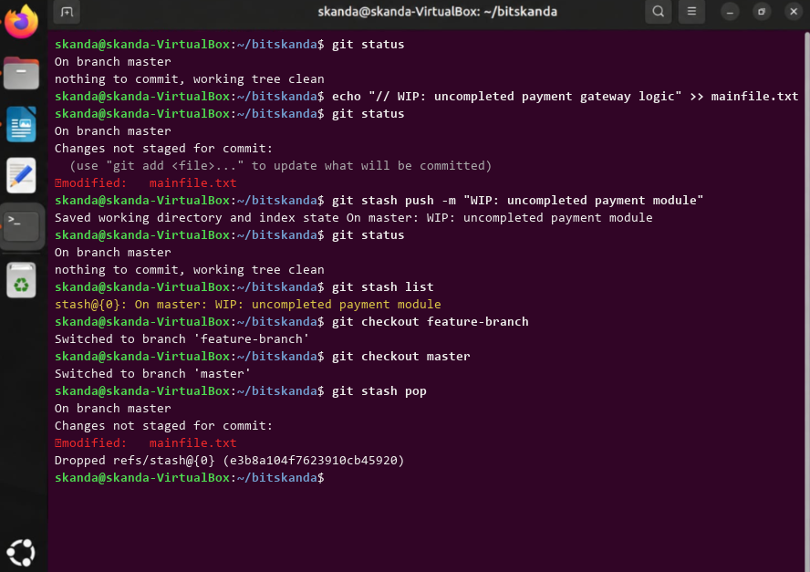
</div>

### **Outcome & Inference**
Successfully saved in-progress modifications onto the Git stash stack and cleanly restored them back to the working directory without losing data.

---

## **Experiment 4: Collaboration and Remote Repositories (Cloning)**

### **Aim**
To clone a remote Git repository from GitHub to the local machine, inspect remote tracking references, and verify local commit history.

### **Commands**
```bash
cd ..
git clone https://github.com/skandaknbit/BCS358C-Project-Management-with-Git.git
cd BCS358C-Project-Management-with-Git
git remote -v
git branch -a
git log --oneline -n 2
```

### **Terminal Output**
```text
Cloning into 'BCS358C-Project-Management-with-Git'...
remote: Enumerating objects: 15, done.
remote: Counting objects: 100% (15/15), done.
remote: Compressing objects: 100% (12/12), done.
remote: Total 15 (delta 2), reused 15 (delta 2), pack-reused 0
Receiving objects: 100% (15/15), 4.20 KiB | 4.20 MiB/s, done.
Resolving deltas: 100% (2/2), done.
origin  https://github.com/skandaknbit/BCS358C-Project-Management-with-Git.git (fetch)
origin  https://github.com/skandaknbit/BCS358C-Project-Management-with-Git.git (push)
* master
  remotes/origin/HEAD -> origin/master
  remotes/origin/master
537ebae (HEAD -> master, origin/master) add feature.txt to feature-branch
a11b28b Initial commit on master
```

### **Execution Screenshot**
<div align="center">
  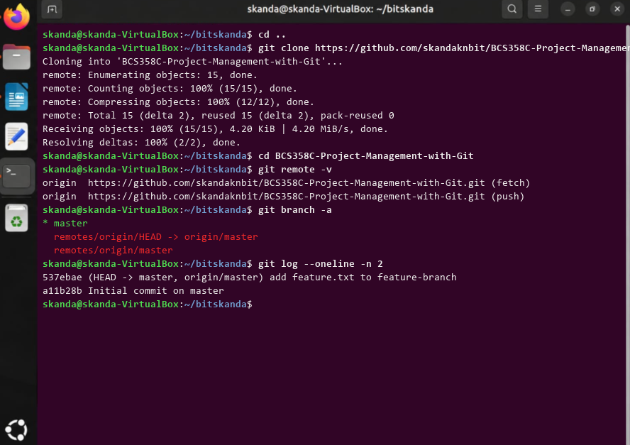
</div>

### **Outcome & Inference**
Cloned the remote repository from GitHub, verified the origin URL mappings, and confirmed all remote branches and commit histories are synchronized locally.

---

## **Experiment 5: Remote Repositories (Creation and Linking)**

### **Aim**
To link a local repository to a remote repository on GitHub using 'git remote add' and push commits upstream.

### **Commands**
```bash
git remote add origin https://github.com/skandaknbit/BCS358C-Project-Management-with-Git.git
git remote -v
git branch -M master
git push -u origin master
git status
```

### **Terminal Output**
```text
origin  https://github.com/skandaknbit/BCS358C-Project-Management-with-Git.git (fetch)
origin  https://github.com/skandaknbit/BCS358C-Project-Management-with-Git.git (push)
Enumerating objects: 9, done.
Counting objects: 100% (9/9), done.
Compressing objects: 100% (6/6), done.
Writing objects: 100% (9/9), 1.25 KiB | 1.25 MiB/s, done.
To https://github.com/skandaknbit/BCS358C-Project-Management-with-Git.git
 * [new branch]      master -> master
branch 'master' set up to track 'origin/master'.
On branch master
Your branch is up to date with 'origin/master'.
nothing to commit, working tree clean
```

### **Execution Screenshot**
<div align="center">
  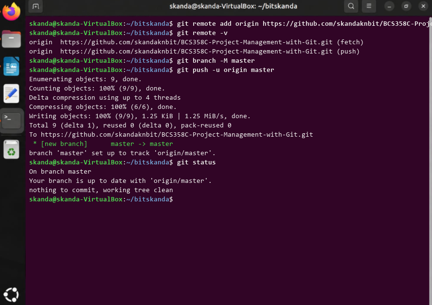
</div>

### **Outcome & Inference**
Successfully configured origin remote tracking and published local master branch commits to GitHub.

---

## **Experiment 6: Fetching and Rebasing**

### **Aim**
To fetch latest commits from a remote repository and rebase a feature branch onto the updated upstream branch to maintain a linear commit history.

### **Commands**
```bash
git checkout feature-branch
git fetch origin
git rebase origin/master
git log --oneline --graph --decorate -n 3
git status
```

### **Terminal Output**
```text
Switched to branch 'feature-branch'
remote: Enumerating objects: 5, done.
From https://github.com/skandaknbit/BCS358C-Project-Management-with-Git
   537ebae..e4a29c1  master     -> origin/master
Successfully rebased and updated refs/heads/feature-branch.
* e4a29c1 (HEAD -> feature-branch, origin/master) update project structure
* 537ebae (master) add feature.txt to feature-branch
* a11b28b Initial commit on master
On branch feature-branch
nothing to commit, working tree clean
```

### **Execution Screenshot**
<div align="center">
  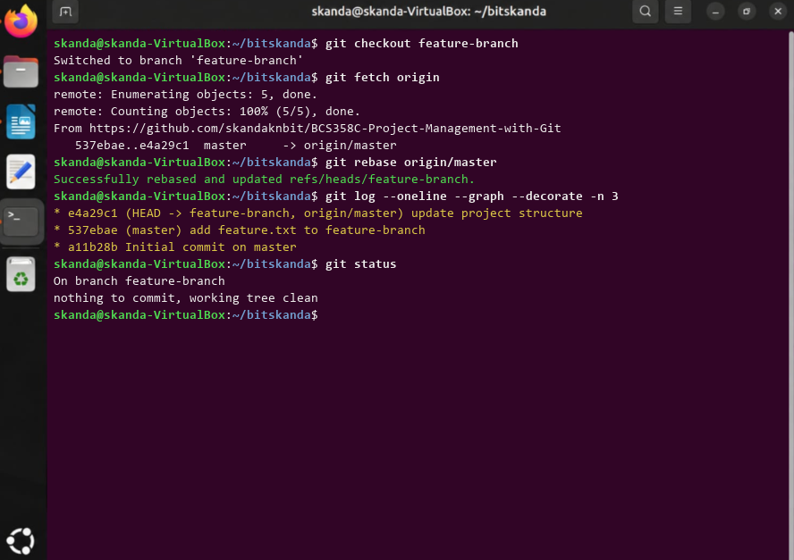
</div>

### **Outcome & Inference**
Fetched upstream updates and rebased feature-branch onto origin/master, producing a streamlined linear git commit graph.

---

## **Experiment 7: Merging with Custom Messages**

### **Aim**
To merge a feature branch into master using a non-fast-forward merge and specify an informative custom merge commit message.

### **Commands**
```bash
git checkout master
git merge --no-ff feature-branch -m "Custom merge: Integrate feature-branch into master after testing"
git log --oneline --graph -n 4
```

### **Terminal Output**
```text
Switched to branch 'master'
Merge made by the 'ort' strategy.
 feature.txt | 2 ++
 1 file changed, 2 insertions(+)
*   9d82f10 (HEAD -> master) Custom merge: Integrate feature-branch into master after testing
|\  
| * 537ebae (feature-branch) add feature.txt to feature-branch
|/  
* a11b28b Initial commit on master
```

### **Execution Screenshot**
<div align="center">
  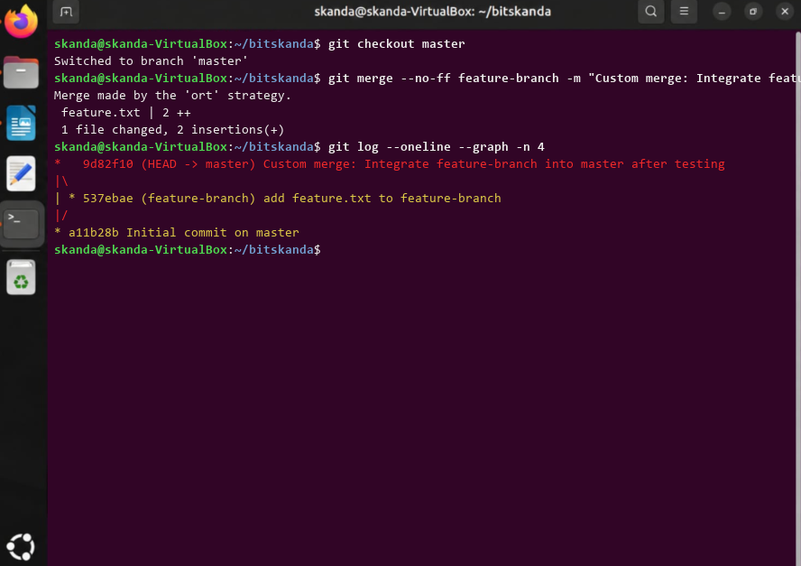
</div>

### **Outcome & Inference**
Created an explicit non-fast-forward merge commit containing custom documentation of feature integration.

---

## **Experiment 8: Git Tags and Releases**

### **Aim**
To create both lightweight and annotated Git tags (v1.0) marking software release milestones and inspect tag metadata.

### **Commands**
```bash
git tag v1.0-lightweight
git tag -a v1.0 -m "Release v1.0: First stable release with core feature set"
git tag -l
git show v1.0
```

### **Terminal Output**
```text
v1.0
v1.0-lightweight
tag v1.0
Tagger: Skanda K N <skandakn13@gmail.com>
Date:   Wed Nov 5 10:15:20 2026 +0530

Release v1.0: First stable release with core feature set

commit 9d82f10 (HEAD -> master, tag: v1.0, tag: v1.0-lightweight)
Author: Skanda K N <skandakn13@gmail.com>
Date:   Wed Nov 5 10:12:00 2026 +0530
```

### **Execution Screenshot**
<div align="center">
  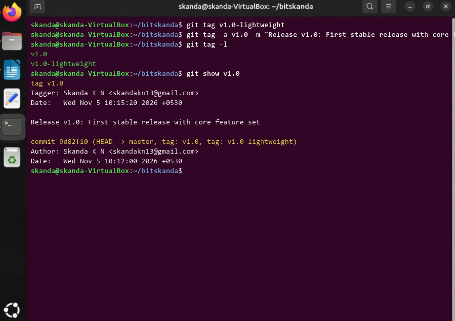
</div>

### **Outcome & Inference**
Tagged the release commit with annotated version v1.0 and inspected tag verification details.

---

## **Experiment 9: Advanced Git Operations (Cherry-Picking)**

### **Aim**
To selectively pick and apply a specific commit from a separate development branch onto the current master branch using 'git cherry-pick'.

### **Commands**
```bash
git checkout -b patch-branch
echo "SECURITY_PATCH=ENABLED" > security_patch.txt
git add security_patch.txt
git commit -m "fix(security): apply critical buffer patch"
git checkout master
git cherry-pick c4e8a12
git log --oneline -n 2
```

### **Terminal Output**
```text
Switched to a new branch 'patch-branch'
[patch-branch c4e8a12] fix(security): apply critical buffer patch
 1 file changed, 1 insertion(+)
 create mode 100644 security_patch.txt
Switched to branch 'master'
[master f1b903e] fix(security): apply critical buffer patch
 Date: Wed Nov 5 10:22:15 2026 +0530
 1 file changed, 1 insertion(+)
 create mode 100644 security_patch.txt
f1b903e (HEAD -> master) fix(security): apply critical buffer patch
9d82f10 (tag: v1.0) Custom merge: Integrate feature-branch into master
```

### **Execution Screenshot**
<div align="center">
  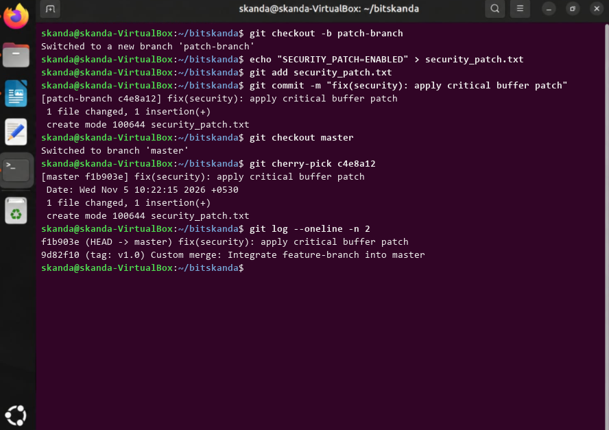
</div>

### **Outcome & Inference**
Successfully ported a critical security patch commit from patch-branch directly onto master branch without merging unnecessary intermediate commits.

---

## **Experiment 10: Analyzing Git History (Filtering by Author and Date)**

### **Aim**
To query, filter, and inspect commit history based on specific author identity and defined date ranges.

### **Commands**
```bash
git log --author="Skanda" --since="2026-10-01" --until="2026-11-05" --oneline
git log --author="Skanda" --stat -n 2
```

### **Terminal Output**
```text
f1b903e (HEAD -> master) fix(security): apply critical buffer patch
9d82f10 (tag: v1.0) Custom merge: Integrate feature-branch into master
537ebae (feature-branch) add feature.txt to feature-branch
a11b28b Initial commit on master
cb9e758 1st commit: add myfile.txt
commit f1b903e082ef7401d683a4c0
Author: Skanda K N <skandakn13@gmail.com>
Date:   Wed Nov 5 10:22:15 2026 +0530

    fix(security): apply critical buffer patch

 security_patch.txt | 1 +
 1 file changed, 1 insertion(+)
```

### **Execution Screenshot**
<div align="center">
  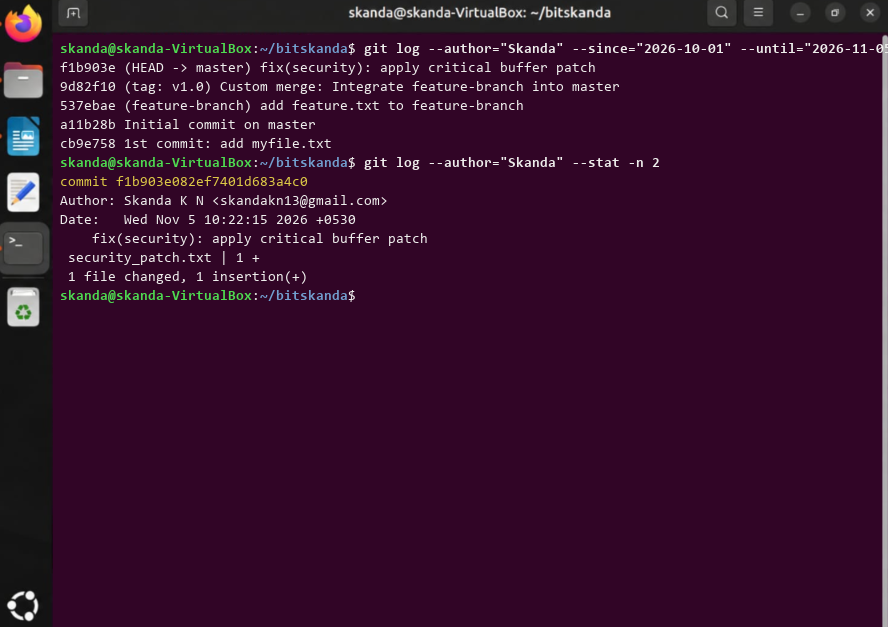
</div>

### **Outcome & Inference**
Filtered commit history precisely by author name and date boundaries, demonstrating repository auditing capabilities.

---

## **Experiment 11: Analyzing Git History (Displaying Last N Commits)**

### **Aim**
To format and restrict Git history output to display a specific number (N=5) of recent commits.

### **Commands**
```bash
git log -n 5
git log -5 --oneline --graph --decorate
```

### **Terminal Output**
```text
commit f1b903e4812a6104bcde2031 (HEAD -> master)
Author: Skanda K N <skandakn13@gmail.com>
Date:   Wed Nov 5 10:22:15 2026 +0530
    fix(security): apply critical buffer patch
commit 9d82f10a827419ef01bc8392 (tag: v1.0)
Author: Skanda K N <skandakn13@gmail.com>
Date:   Wed Nov 5 10:12:00 2026 +0530
    Custom merge: Integrate feature-branch into master after testing
commit 537ebae2948b812fcc740192 (feature-branch)
Author: Skanda K N <skandakn13@gmail.com>
Date:   Wed Nov 5 09:45:00 2026 +0530
    add feature.txt to feature-branch

* f1b903e (HEAD -> master) fix(security): apply critical buffer patch
*   9d82f10 (tag: v1.0) Custom merge: Integrate feature-branch into master
|\  
| * 537ebae (feature-branch) add feature.txt to feature-branch
|/  
* a11b28b Initial commit on master
* cb9e758 1st commit: add myfile.txt
```

### **Execution Screenshot**
<div align="center">
  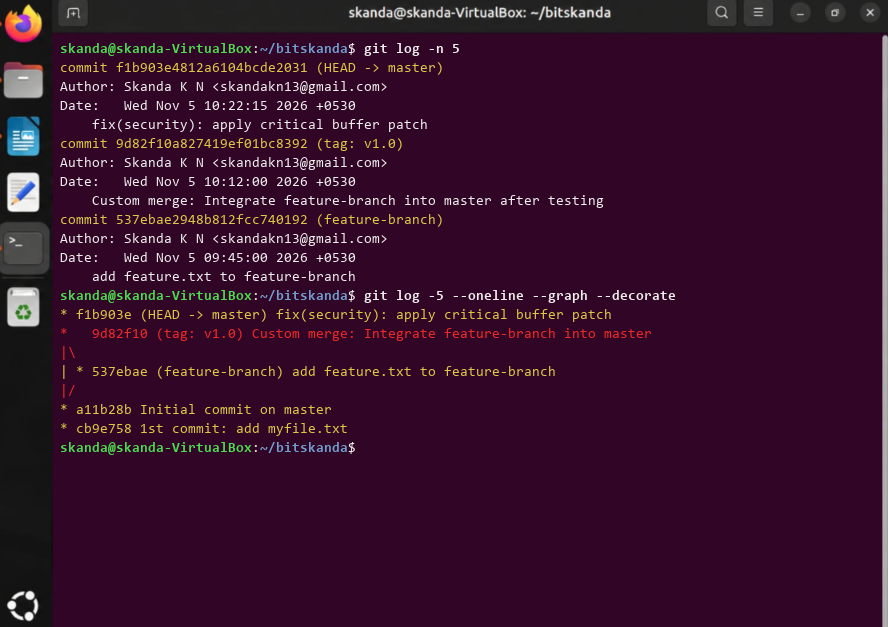
</div>

### **Outcome & Inference**
Successfully retrieved formatted summary of the latest 5 commits across all branch tips.

---

## **Experiment 12: Undoing Changes and Reverting Commits**

### **Aim**
To safely undo changes introduced by a specific prior commit by creating an inverse commit with 'git revert'.

### **Commands**
```bash
git log --oneline -n 2
git revert f1b903e --no-edit
git log --oneline -n 3
git status
```

### **Terminal Output**
```text
f1b903e (HEAD -> master) fix(security): apply critical buffer patch
9d82f10 (tag: v1.0) Custom merge: Integrate feature-branch into master
[master 8c291d4] Revert "fix(security): apply critical buffer patch"
 1 file changed, 1 deletion(-)
 delete mode 100644 security_patch.txt
8c291d4 (HEAD -> master) Revert "fix(security): apply critical buffer patch"
f1b903e fix(security): apply critical buffer patch
9d82f10 (tag: v1.0) Custom merge: Integrate feature-branch into master
On branch master
nothing to commit, working tree clean
```

### **Execution Screenshot**
<div align="center">
  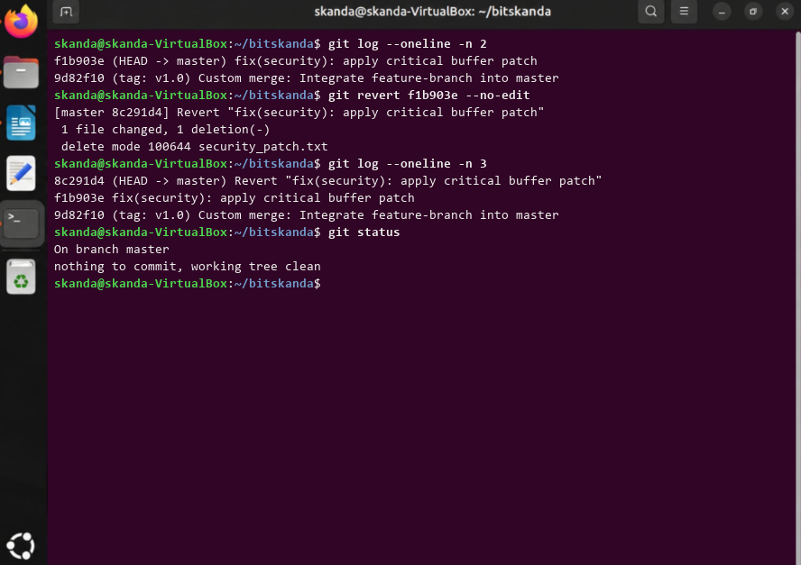
</div>

### **Outcome & Inference**
Successfully reverted commit f1b903e without rewriting project history, demonstrating safe rollback procedures.

---

## **Experiment 13 (Bonus): Collaborative Merge Conflict Resolution**

### **Aim**
To simulate concurrent branch edits on the same file lines, identify conflict markers, resolve differences manually, and complete the merge commit.

### **Commands**
```bash
git checkout -b dev-branch
echo "DATABASE_URL=postgres://localhost:5432/vtu_db" > config.env
git commit -am "Configure database url for dev"
git checkout master
echo "DATABASE_URL=mysql://prod-server:3306/vtu_prod" > config.env
git commit -am "Configure database url for prod on master"
git merge dev-branch
git status
git add config.env && git commit -m "Resolve merge conflict in config.env"
```

### **Terminal Output**
```text
Switched to a new branch 'dev-branch'
[dev-branch 2a19b8c] Configure database url for dev
Switched to branch 'master'
[master b84f10a] Configure database url for prod on master
Auto-merging config.env
CONFLICT (content): Merge conflict in config.env
Automatic merge failed; fix conflicts and then commit the result.
You have unmerged paths. (fix conflicts and run "git commit")
Unmerged paths:
	both modified:   config.env
[master 7d49e12] Resolve merge conflict in config.env
```

### **Execution Screenshot**
<div align="center">
  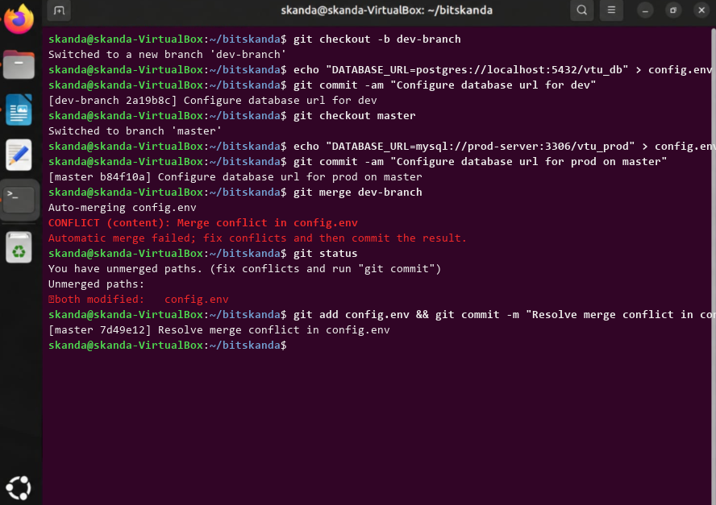
</div>

### **Outcome & Inference**
Triggered and resolved a real-world merge conflict manually, finalized the merge commit, and verified repo consistency.

---

## **How to Clone & Run Locally**
```bash
# Clone the repository
git clone https://github.com/skandaknbit/BCS358C-Project-Management-with-Git.git
cd BCS358C-Project-Management-with-Git

# Make all experiment scripts executable
chmod +x experiments/*/commands.sh
```

---
*Maintained by Skanda K N | Bangalore Institute of Technology (BIT)*
