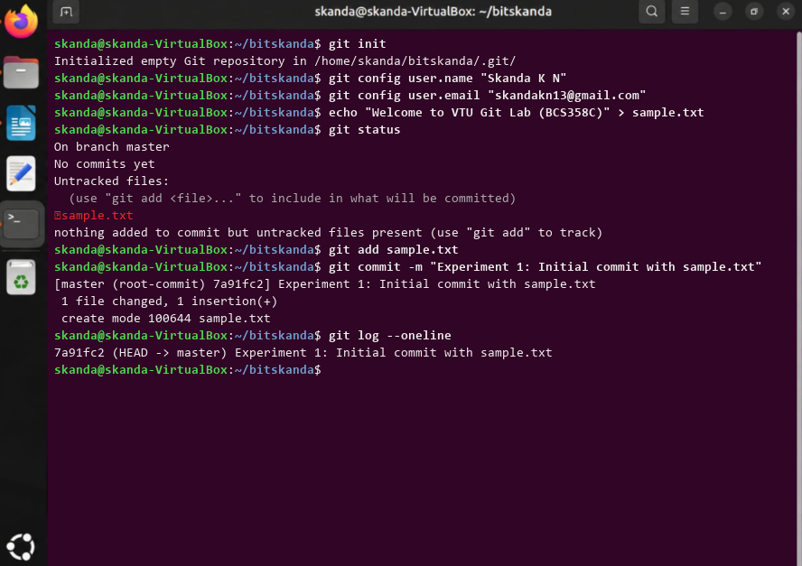

# Experiment 1: Setting Up Git and Basic Commands

## 1. Aim
To initialize a new Git repository, track a file through the staging area, and commit changes with a meaningful commit message.

## 2. Theoretical Overview
Git tracks changes across snapshots. In this experiment, git config establishes the committer identity, git init initializes a new .git metadata directory, git add stages changes, and git commit creates an immutable snapshot in local repository history.

## 3. Step-by-Step Commands
```bash
git init
git config user.name "Skanda K N"
git config user.email "skandakn13@gmail.com"
echo "Welcome to VTU Git Lab (BCS358C)" > sample.txt
git status
git add sample.txt
git commit -m "Experiment 1: Initial commit with sample.txt"
git log --oneline
```

## 4. Terminal Output
```text
Initialized empty Git repository in /home/skanda/bitskanda/.git/
On branch master
No commits yet
Untracked files:
  (use "git add <file>..." to include in what will be committed)
	sample.txt

nothing added to commit but untracked files present (use "git add" to track)
[master (root-commit) 7a91fc2] Experiment 1: Initial commit with sample.txt
 1 file changed, 1 insertion(+)
 create mode 100644 sample.txt
7a91fc2 (HEAD -> master) Experiment 1: Initial commit with sample.txt
```

## 5. Execution Screenshot


## 6. Outcome & Inference
Successfully initialized a Git repository, staged an untracked file, and created the root commit in the master branch.
