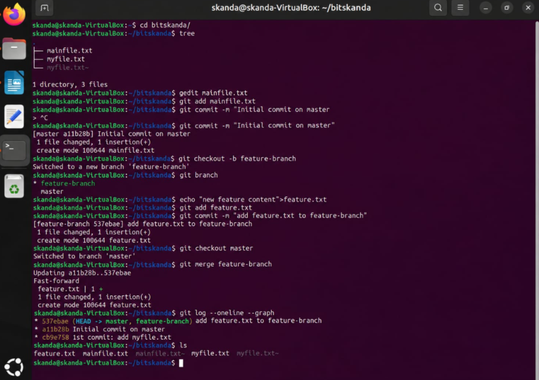

# Experiment 2: Creating and Managing Branches

## 1. Aim
To create a new branch named 'feature-branch', switch between branches, make isolated changes, and merge 'feature-branch' into 'master' using fast-forward merge.

## 2. Theoretical Overview
Branching in Git provides an isolated environment for developing new features without disrupting the main production branch (master/main). Merging incorporates the branch's commit history back into the target branch.

## 3. Step-by-Step Commands
```bash
cd bitskanda/
tree
gedit mainfile.txt
git add mainfile.txt
git commit -m "Initial commit on master"
git checkout -b feature-branch
git branch
echo "new feature content">feature.txt
git add feature.txt
git commit -m "add feature.txt to feature-branch"
git checkout master
git merge feature-branch
git log --oneline --graph
ls
```

## 4. Terminal Output
```text
.
├── mainfile.txt
├── myfile.txt
└── myfile.txt~

1 directory, 3 files
[master a11b28b] Initial commit on master
 1 file changed, 1 insertion(+)
 create mode 100644 mainfile.txt
Switched to a new branch 'feature-branch'
* feature-branch
  master
[feature-branch 537ebae] add feature.txt to feature-branch
 1 file changed, 1 insertion(+)
 create mode 100644 feature.txt
Switched to branch 'master'
Updating a11b28b..537ebae
Fast-forward
 feature.txt | 1 +
 1 file changed, 1 insertion(+)
 create mode 100644 feature.txt
* 537ebae (HEAD -> master, feature-branch) add feature.txt to feature-branch
* a11b28b Initial commit on master
* cb9e758 1st commit: add myfile.txt
feature.txt  mainfile.txt  mainfile.txt~  myfile.txt  myfile.txt~
```

## 5. Execution Screenshot


## 6. Outcome & Inference
Successfully created feature-branch, added and committed feature.txt, switched to master, and performed a clean fast-forward merge into master.
