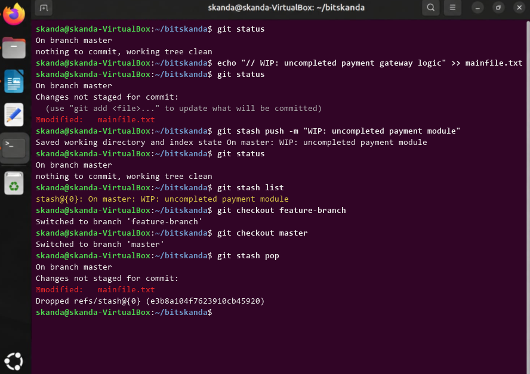

# Experiment 3: Branch Stashing

## 1. Aim
To temporarily shelve (stash) uncommitted working directory changes, switch branches with a clean working tree, and restore stashed changes.

## 2. Theoretical Overview
git stash temporarily records the current state of the working directory and index without committing, allowing developers to switch tasks or branches cleanly and later restore their work using git stash pop or git stash apply.

## 3. Step-by-Step Commands
```bash
git status
echo "// WIP: uncompleted payment gateway logic" >> mainfile.txt
git status
git stash push -m "WIP: uncompleted payment module"
git status
git stash list
git checkout feature-branch
git checkout master
git stash pop
git status
```

## 4. Terminal Output
```text
Saved working directory and index state On master: WIP: uncompleted payment module
On branch master
nothing to commit, working tree clean
stash@{0}: On master: WIP: uncompleted payment module
Switched to branch 'feature-branch'
Switched to branch 'master'
On branch master
Changes not staged for commit:
	modified:   mainfile.txt
Dropped refs/stash@{0} (e3b8a104f7623910cb45920)
```

## 5. Execution Screenshot


## 6. Outcome & Inference
Successfully saved in-progress modifications onto the Git stash stack and cleanly restored them back to the working directory without losing data.
