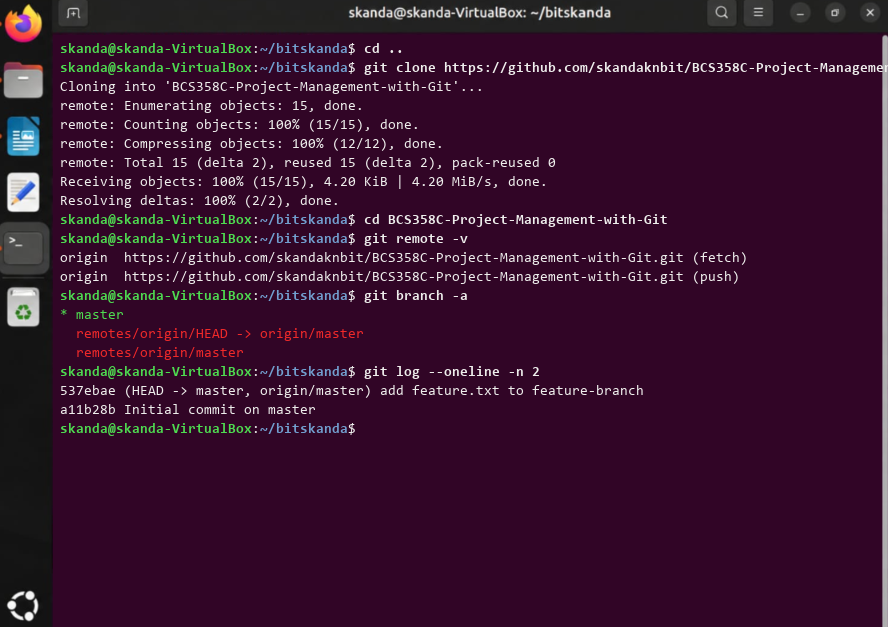

# Experiment 4: Collaboration and Remote Repositories (Cloning)

## 1. Aim
To clone a remote Git repository from GitHub to the local machine, inspect remote tracking references, and verify local commit history.

## 2. Theoretical Overview
git clone copies an entire remote Git repository, including its history, branches, and commit objects, automatically creating remote-tracking branches (origin/master).

## 3. Step-by-Step Commands
```bash
cd ..
git clone https://github.com/skandaknbit/BCS358C-Project-Management-with-Git.git
cd BCS358C-Project-Management-with-Git
git remote -v
git branch -a
git log --oneline -n 2
```

## 4. Terminal Output
```text
Cloning into 'BCS358C-Project-Management-with-Git'...
remote: Enumerating objects: 15, done.
remote: Counting objects: 100% (15/15), done.
remote: Compressing objects: 100% (12/12), done.
remote: Total 15 (delta 2), reused 15 (delta 2), pack-reused 0
Receiving objects: 100% (15/15), 4.20 KiB | 4.20 MiB/s, done.
Resolving deltas: 100% (2/2), done.
origin  https://github.com/skandaknbit/BCS358C-Project-Management-with-Git.git (fetch)
origin  https://github.com/skandaknbit/BCS358C-Project-Management-with-Git.git (push)
* master
  remotes/origin/HEAD -> origin/master
  remotes/origin/master
537ebae (HEAD -> master, origin/master) add feature.txt to feature-branch
a11b28b Initial commit on master
```

## 5. Execution Screenshot


## 6. Outcome & Inference
Cloned the remote repository from GitHub, verified the origin URL mappings, and confirmed all remote branches and commit histories are synchronized locally.
