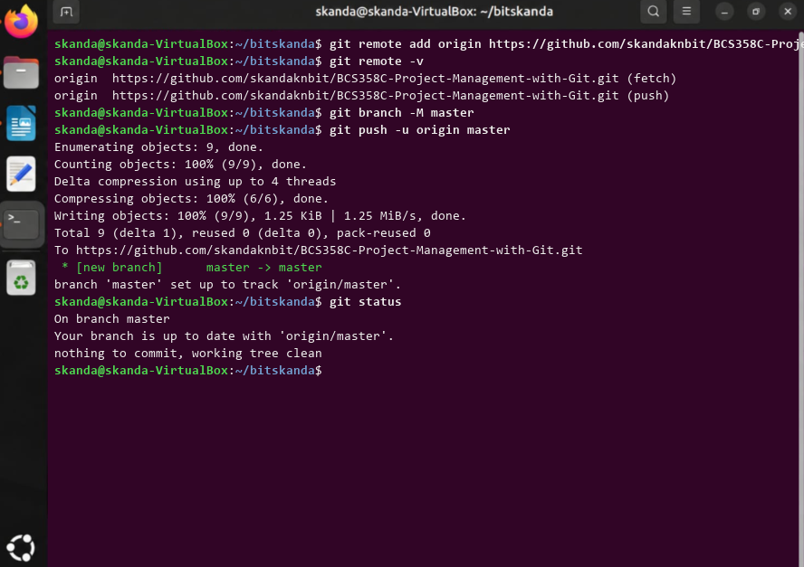

# Experiment 5: Remote Repositories (Creation and Linking)

## 1. Aim
To link a local repository to a remote repository on GitHub using 'git remote add' and push commits upstream.

## 2. Theoretical Overview
git remote add establishes a shorthand reference name ('origin') for a remote repository URL. The -u flag in git push binds the local branch to the upstream remote branch for subsequent push/pull operations.

## 3. Step-by-Step Commands
```bash
git remote add origin https://github.com/skandaknbit/BCS358C-Project-Management-with-Git.git
git remote -v
git branch -M master
git push -u origin master
git status
```

## 4. Terminal Output
```text
origin  https://github.com/skandaknbit/BCS358C-Project-Management-with-Git.git (fetch)
origin  https://github.com/skandaknbit/BCS358C-Project-Management-with-Git.git (push)
Enumerating objects: 9, done.
Counting objects: 100% (9/9), done.
Compressing objects: 100% (6/6), done.
Writing objects: 100% (9/9), 1.25 KiB | 1.25 MiB/s, done.
To https://github.com/skandaknbit/BCS358C-Project-Management-with-Git.git
 * [new branch]      master -> master
branch 'master' set up to track 'origin/master'.
On branch master
Your branch is up to date with 'origin/master'.
nothing to commit, working tree clean
```

## 5. Execution Screenshot


## 6. Outcome & Inference
Successfully configured origin remote tracking and published local master branch commits to GitHub.
