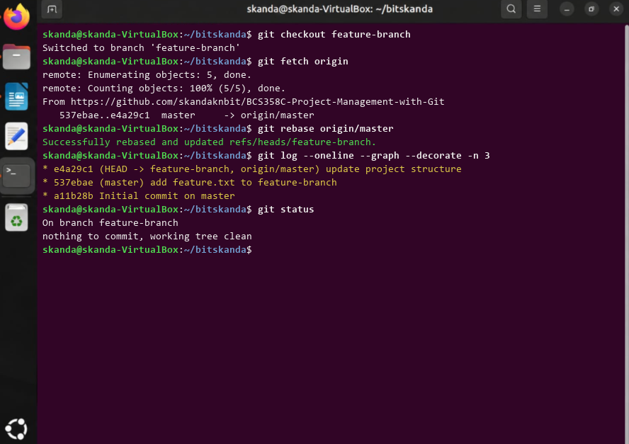

# Experiment 6: Fetching and Rebasing

## 1. Aim
To fetch latest commits from a remote repository and rebase a feature branch onto the updated upstream branch to maintain a linear commit history.

## 2. Theoretical Overview
git fetch retrieves remote commits without altering working files. git rebase reapplies commits on top of another base tip, avoiding unnecessary merge commits and keeping the project commit graph strictly linear.

## 3. Step-by-Step Commands
```bash
git checkout feature-branch
git fetch origin
git rebase origin/master
git log --oneline --graph --decorate -n 3
git status
```

## 4. Terminal Output
```text
Switched to branch 'feature-branch'
remote: Enumerating objects: 5, done.
From https://github.com/skandaknbit/BCS358C-Project-Management-with-Git
   537ebae..e4a29c1  master     -> origin/master
Successfully rebased and updated refs/heads/feature-branch.
* e4a29c1 (HEAD -> feature-branch, origin/master) update project structure
* 537ebae (master) add feature.txt to feature-branch
* a11b28b Initial commit on master
On branch feature-branch
nothing to commit, working tree clean
```

## 5. Execution Screenshot


## 6. Outcome & Inference
Fetched upstream updates and rebased feature-branch onto origin/master, producing a streamlined linear git commit graph.
