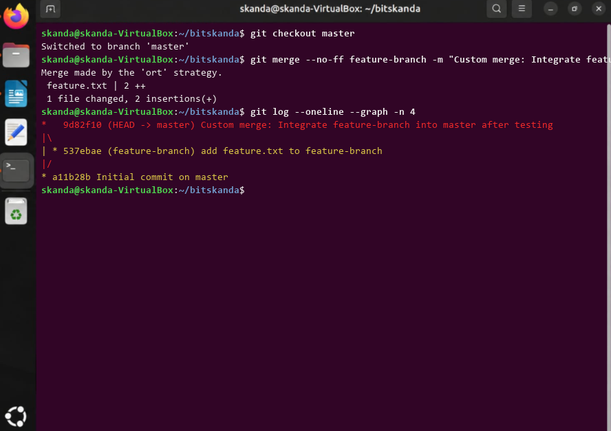

# Experiment 7: Merging with Custom Messages

## 1. Aim
To merge a feature branch into master using a non-fast-forward merge and specify an informative custom merge commit message.

## 2. Theoretical Overview
Using git merge --no-ff forces Git to create a merge commit even if a fast-forward merge is possible. Supplying -m allows developers to record explicit reasoning and auditing details for the merge.

## 3. Step-by-Step Commands
```bash
git checkout master
git merge --no-ff feature-branch -m "Custom merge: Integrate feature-branch into master after testing"
git log --oneline --graph -n 4
```

## 4. Terminal Output
```text
Switched to branch 'master'
Merge made by the 'ort' strategy.
 feature.txt | 2 ++
 1 file changed, 2 insertions(+)
*   9d82f10 (HEAD -> master) Custom merge: Integrate feature-branch into master after testing
|\  
| * 537ebae (feature-branch) add feature.txt to feature-branch
|/  
* a11b28b Initial commit on master
```

## 5. Execution Screenshot


## 6. Outcome & Inference
Created an explicit non-fast-forward merge commit containing custom documentation of feature integration.
