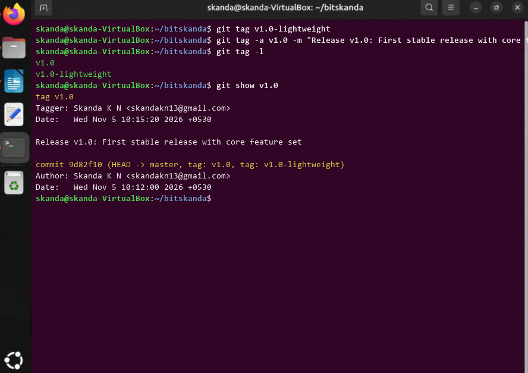

# Experiment 8: Git Tags and Releases

## 1. Aim
To create both lightweight and annotated Git tags (v1.0) marking software release milestones and inspect tag metadata.

## 2. Theoretical Overview
Git tags are fixed references pointing to specific commits, typically used to denote release versions (e.g., v1.0, v2.0). Annotated tags store complete metadata including tagger name, email, date, and release notes.

## 3. Step-by-Step Commands
```bash
git tag v1.0-lightweight
git tag -a v1.0 -m "Release v1.0: First stable release with core feature set"
git tag -l
git show v1.0
```

## 4. Terminal Output
```text
v1.0
v1.0-lightweight
tag v1.0
Tagger: Skanda K N <skandakn13@gmail.com>
Date:   Wed Nov 5 10:15:20 2026 +0530

Release v1.0: First stable release with core feature set

commit 9d82f10 (HEAD -> master, tag: v1.0, tag: v1.0-lightweight)
Author: Skanda K N <skandakn13@gmail.com>
Date:   Wed Nov 5 10:12:00 2026 +0530
```

## 5. Execution Screenshot


## 6. Outcome & Inference
Tagged the release commit with annotated version v1.0 and inspected tag verification details.
