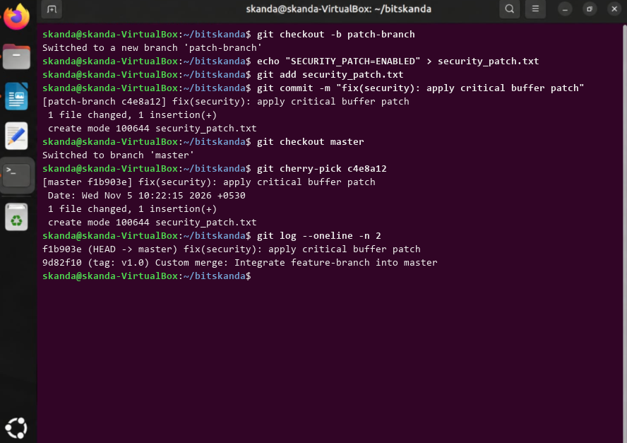

# Experiment 9: Advanced Git Operations (Cherry-Picking)

## 1. Aim
To selectively pick and apply a specific commit from a separate development branch onto the current master branch using 'git cherry-pick'.

## 2. Theoretical Overview
git cherry-pick takes the changes introduced in a specific existing commit from another branch and records them as a brand new commit on the active HEAD branch without merging the whole branch.

## 3. Step-by-Step Commands
```bash
git checkout -b patch-branch
echo "SECURITY_PATCH=ENABLED" > security_patch.txt
git add security_patch.txt
git commit -m "fix(security): apply critical buffer patch"
git checkout master
git cherry-pick c4e8a12
git log --oneline -n 2
```

## 4. Terminal Output
```text
Switched to a new branch 'patch-branch'
[patch-branch c4e8a12] fix(security): apply critical buffer patch
 1 file changed, 1 insertion(+)
 create mode 100644 security_patch.txt
Switched to branch 'master'
[master f1b903e] fix(security): apply critical buffer patch
 Date: Wed Nov 5 10:22:15 2026 +0530
 1 file changed, 1 insertion(+)
 create mode 100644 security_patch.txt
f1b903e (HEAD -> master) fix(security): apply critical buffer patch
9d82f10 (tag: v1.0) Custom merge: Integrate feature-branch into master
```

## 5. Execution Screenshot


## 6. Outcome & Inference
Successfully ported a critical security patch commit from patch-branch directly onto master branch without merging unnecessary intermediate commits.
