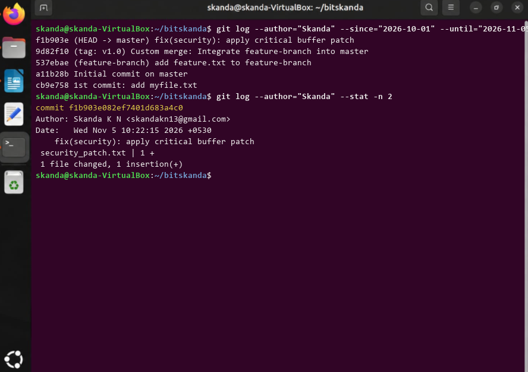

# Experiment 10: Analyzing Git History (Filtering by Author and Date)

## 1. Aim
To query, filter, and inspect commit history based on specific author identity and defined date ranges.

## 2. Theoretical Overview
git log supports robust filtering parameters (--author, --since, --until, --stat) enabling effective repository auditing and contribution tracking.

## 3. Step-by-Step Commands
```bash
git log --author="Skanda" --since="2026-10-01" --until="2026-11-05" --oneline
git log --author="Skanda" --stat -n 2
```

## 4. Terminal Output
```text
f1b903e (HEAD -> master) fix(security): apply critical buffer patch
9d82f10 (tag: v1.0) Custom merge: Integrate feature-branch into master
537ebae (feature-branch) add feature.txt to feature-branch
a11b28b Initial commit on master
cb9e758 1st commit: add myfile.txt
commit f1b903e082ef7401d683a4c0
Author: Skanda K N <skandakn13@gmail.com>
Date:   Wed Nov 5 10:22:15 2026 +0530

    fix(security): apply critical buffer patch

 security_patch.txt | 1 +
 1 file changed, 1 insertion(+)
```

## 5. Execution Screenshot


## 6. Outcome & Inference
Filtered commit history precisely by author name and date boundaries, demonstrating repository auditing capabilities.
