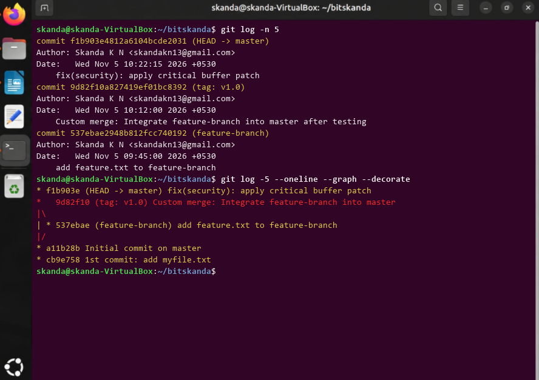

# Experiment 11: Analyzing Git History (Displaying Last N Commits)

## 1. Aim
To format and restrict Git history output to display a specific number (N=5) of recent commits.

## 2. Theoretical Overview
Limiting log output using -n or -<count> coupled with --graph and --decorate provides concise visual snapshots of recent project progression.

## 3. Step-by-Step Commands
```bash
git log -n 5
git log -5 --oneline --graph --decorate
```

## 4. Terminal Output
```text
commit f1b903e4812a6104bcde2031 (HEAD -> master)
Author: Skanda K N <skandakn13@gmail.com>
Date:   Wed Nov 5 10:22:15 2026 +0530
    fix(security): apply critical buffer patch
commit 9d82f10a827419ef01bc8392 (tag: v1.0)
Author: Skanda K N <skandakn13@gmail.com>
Date:   Wed Nov 5 10:12:00 2026 +0530
    Custom merge: Integrate feature-branch into master after testing
commit 537ebae2948b812fcc740192 (feature-branch)
Author: Skanda K N <skandakn13@gmail.com>
Date:   Wed Nov 5 09:45:00 2026 +0530
    add feature.txt to feature-branch

* f1b903e (HEAD -> master) fix(security): apply critical buffer patch
*   9d82f10 (tag: v1.0) Custom merge: Integrate feature-branch into master
|\  
| * 537ebae (feature-branch) add feature.txt to feature-branch
|/  
* a11b28b Initial commit on master
* cb9e758 1st commit: add myfile.txt
```

## 5. Execution Screenshot


## 6. Outcome & Inference
Successfully retrieved formatted summary of the latest 5 commits across all branch tips.
