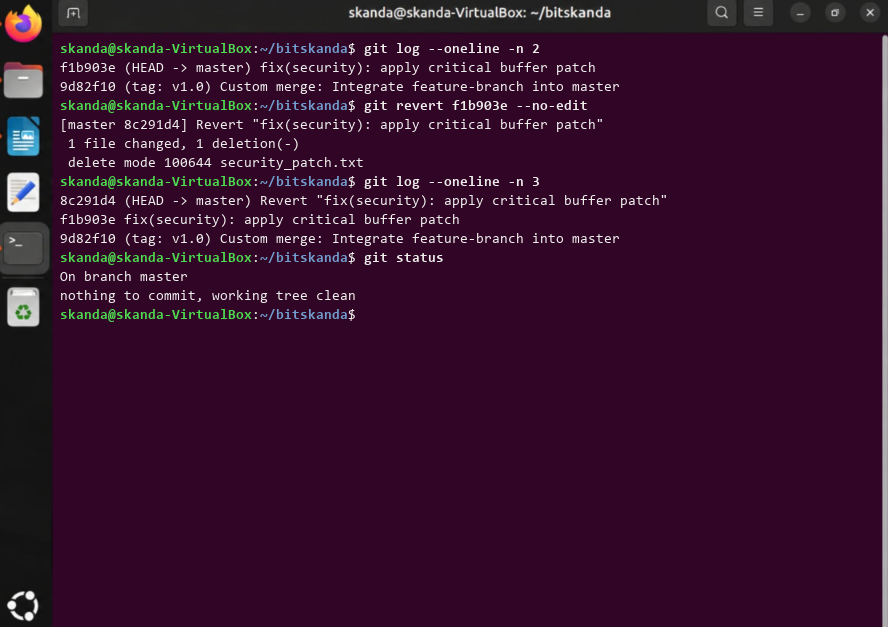

# Experiment 12: Undoing Changes and Reverting Commits

## 1. Aim
To safely undo changes introduced by a specific prior commit by creating an inverse commit with 'git revert'.

## 2. Theoretical Overview
Unlike git reset which modifies commit history, git revert appends a new commit that records the inverse diff of an existing commit, safely undoing regressions while preserving commit auditing history.

## 3. Step-by-Step Commands
```bash
git log --oneline -n 2
git revert f1b903e --no-edit
git log --oneline -n 3
git status
```

## 4. Terminal Output
```text
f1b903e (HEAD -> master) fix(security): apply critical buffer patch
9d82f10 (tag: v1.0) Custom merge: Integrate feature-branch into master
[master 8c291d4] Revert "fix(security): apply critical buffer patch"
 1 file changed, 1 deletion(-)
 delete mode 100644 security_patch.txt
8c291d4 (HEAD -> master) Revert "fix(security): apply critical buffer patch"
f1b903e fix(security): apply critical buffer patch
9d82f10 (tag: v1.0) Custom merge: Integrate feature-branch into master
On branch master
nothing to commit, working tree clean
```

## 5. Execution Screenshot


## 6. Outcome & Inference
Successfully reverted commit f1b903e without rewriting project history, demonstrating safe rollback procedures.
