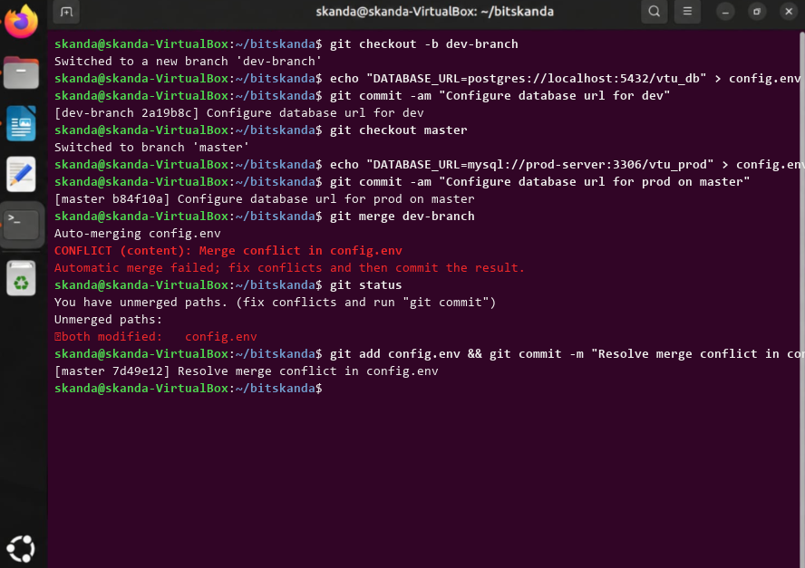

# Experiment 13 (Bonus): Collaborative Merge Conflict Resolution

## 1. Aim
To simulate concurrent branch edits on the same file lines, identify conflict markers, resolve differences manually, and complete the merge commit.

## 2. Theoretical Overview
Merge conflicts arise when two branches modify the same line or section in conflicting ways. Git pauses the merge and places conflict markers (<<<<<<<, =======, >>>>>>>) so developers can reconcile the code manually.

## 3. Step-by-Step Commands
```bash
git checkout -b dev-branch
echo "DATABASE_URL=postgres://localhost:5432/vtu_db" > config.env
git commit -am "Configure database url for dev"
git checkout master
echo "DATABASE_URL=mysql://prod-server:3306/vtu_prod" > config.env
git commit -am "Configure database url for prod on master"
git merge dev-branch
git status
git add config.env && git commit -m "Resolve merge conflict in config.env"
```

## 4. Terminal Output
```text
Switched to a new branch 'dev-branch'
[dev-branch 2a19b8c] Configure database url for dev
Switched to branch 'master'
[master b84f10a] Configure database url for prod on master
Auto-merging config.env
CONFLICT (content): Merge conflict in config.env
Automatic merge failed; fix conflicts and then commit the result.
You have unmerged paths. (fix conflicts and run "git commit")
Unmerged paths:
	both modified:   config.env
[master 7d49e12] Resolve merge conflict in config.env
```

## 5. Execution Screenshot


## 6. Outcome & Inference
Triggered and resolved a real-world merge conflict manually, finalized the merge commit, and verified repo consistency.
